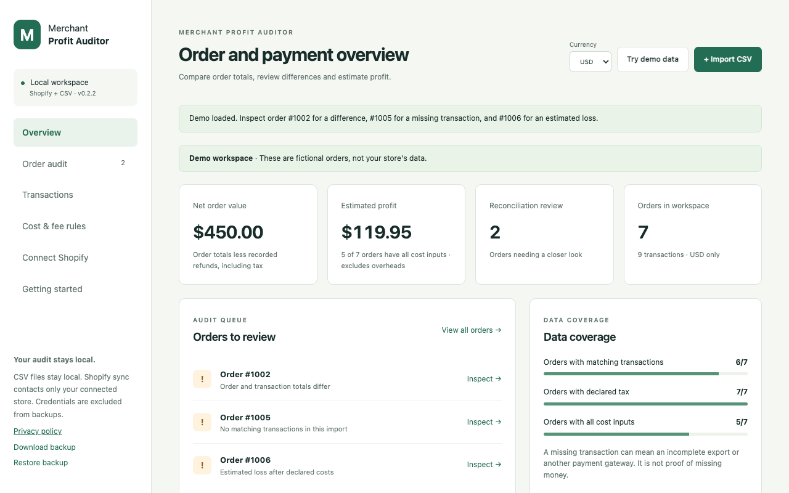
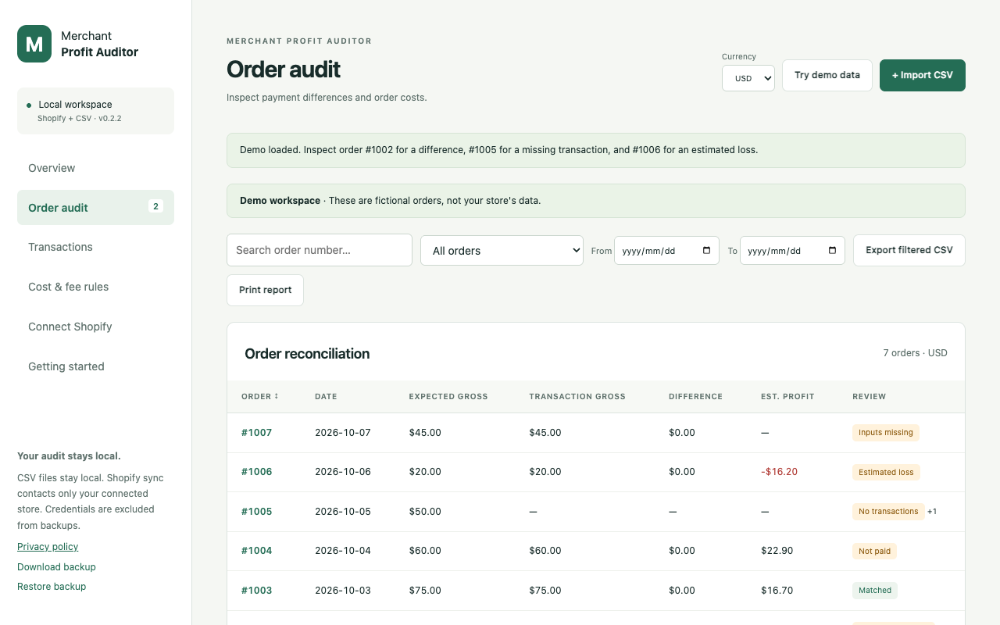
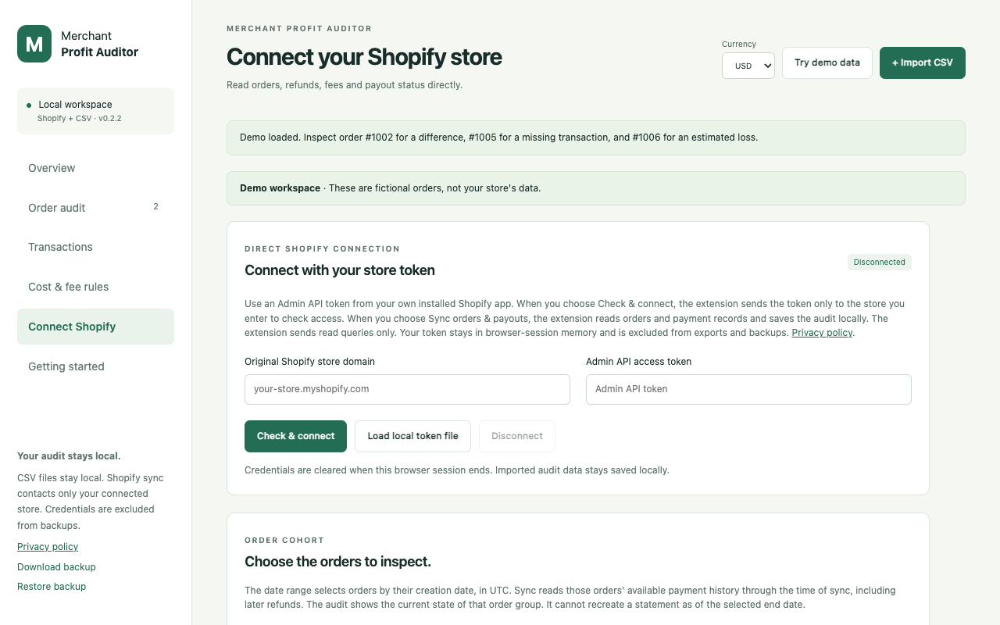

# Merchant Profit Auditor

Reconcile Shopify orders, payment fees, refunds and payouts. Estimate order profit with your costs using local CSV imports or optional direct Shopify sync.

[Product guide](https://thexerer.github.io/merchant-profit-auditor-privacy/product.html) · [Privacy policy](https://thexerer.github.io/merchant-profit-auditor-privacy/) · [Support and feature requests](https://github.com/thexerer/merchant-profit-auditor-privacy/issues)

**[Install from the Chrome Web Store](https://chromewebstore.google.com/detail/merchant-profit-auditor/pgbfjopdhkocaiijmjefhhlnkchagiod)**

## Check what your orders earned after fees and costs.

Compare order totals with payment transactions and payout records. Review mismatches, refunds and pending payouts, then estimate order profit using the costs you supply.

### Reconcile orders and payments

Match orders with charges and refunds, including split payments. Review missing transactions, unlinked records, fee differences and payout groups.

### Import CSVs or connect Shopify

Import orders, balance transactions and SKU costs with column previews. Optional direct sync uses your approved store and an Admin API token from your own installed Shopify app.

### Estimate profit with your costs

Enter SKU costs, shipping and advertising assumptions. Override costs and retained tax for individual orders. Missing inputs stay visible and currencies remain separate.

### Export what needs review

Search and filter the audit by dates, discrepancies, pending payouts, missing costs or estimated losses. Export filtered CSVs, print reports or create a local backup.

## Screenshots

## Getting started

1. Install Merchant Profit Auditor from the Chrome Web Store and open its workspace.
2. Start with fictional demo data, or import order, payment and SKU-cost CSV files. Check the column mapping before saving each dataset.
3. For optional Shopify sync, approve your store domain and enter your own Admin API token with the required read scopes.
4. Set product, shipping and advertising costs. Review missing costs before interpreting estimated profit.
5. Inspect order, transaction and payout differences. Export a filtered CSV or print a report for further review.

## Frequently asked questions

### Can I audit Shopify orders without connecting my store?

Yes. CSV auditing runs locally without a store connection or developer server. You can try fictional demo data and sample CSVs first.

### What does direct Shopify sync require?

Your own installed Shopify app and Admin API token with read_orders, read_shopify_payments_accounts and read_shopify_payments_payouts access. Shopify Payments must be active. This release has no one-click public Shopify installation. Older orders require additional approved read_all_orders access.

### Does a fee difference prove Shopify overcharged me?

No. A discrepancy is a record that needs review. It does not establish overcharging, recovered money or accounting accuracy.

### Is estimated profit my final net profit?

No. Estimates depend on complete records and the costs entered. They do not include every overhead or income tax. Different currencies remain separate; exchange rates are not invented.

### Can the report recreate a historical bank statement?

No. Sync selects orders by creation date in UTC and reads their available payment history through sync time, including later refunds. The audit reflects the current state of those orders.

### Is Merchant Profit Auditor affiliated with Shopify?

No. It is an independent Chrome extension. It does not access your bank account, request store write scopes or certify accounting accuracy.

## Privacy and data handling

Audit records and cost rules stay in local browser storage. Optional Shopify requests go only to the store you approve. Tokens stay in browser-session storage and are excluded from exports and backups. There is no developer server, advertising or analytics. [Read the full policy](https://thexerer.github.io/merchant-profit-auditor-privacy/).

## Release status

Screenshots show version 0.2.2 with fictional demo data. The Shopify setup view is disconnected and does not imply a tested live-store sync.

## Support

[Open an issue](https://github.com/thexerer/merchant-profit-auditor-privacy/issues) with the steps to reproduce a problem, your Chrome version and the extension version. Keep tokens, customer records, private notes and recordings out of public issues.

This repository contains product documentation, screenshots and the public privacy policy. It is not the extension source-code distribution.
